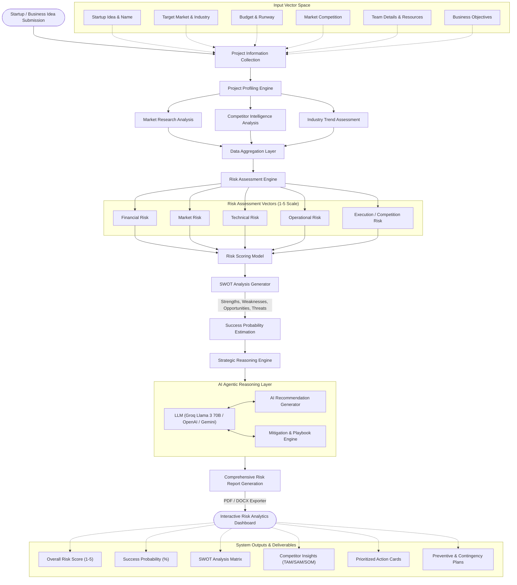
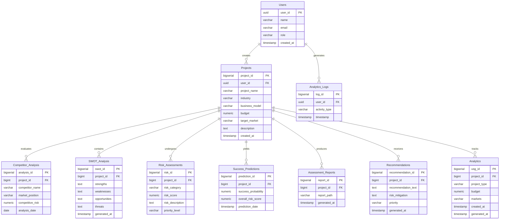

# Failure Prediction AI – Startup & Project Risk Analyzer
### Technical & Project Specification Documentation

---

```
  ███████╗ █████╗ ██╗██╗     ██╗   ██╗██████╗ ███████╗    ██████╗ ██████╗ ███████╗██████╗ ██╗ ██████╗████████╗██╗ ██████╗ ███╗   ██╗
  ██╔════╝██╔══██╗██║██║     ██║   ██║██╔══██╗██╔════╝    ██╔══██╗██╔══██╗██╔════╝██╔══██╗██║██╔════╝╚══██╔══╝██║██╔═══██╗████╗  ██║
  █████╗  ███████║██║██║     ██║   ██║██████╔╝█████╗      ██████╔╝██████╔╝█████╗  ██║  ██║██║██║        ██║   ██║██║   ██║██╔██╗ ██║
  ██╔══╝  ██╔══██║██║██║     ██║   ██║██╔══██╗██╔══╝      ██╔═══╝ ██╔══██╗██╔══╝  ██║  ██║██║██║        ██║   ██║██║   ██║██║╚██╗██║
  ██║     ██║  ██║██║███████╗╚██████╔╝██║  ██║███████╗    ██║     ██║  ██║███████╗██████╔╝██║╚██████╗   ██║   ██║╚██████╔╝██║ ╚████║
  ╚═╝     ╚═╝  ╚═╝╚═╝╚══════╝ ╚═════╝ ╚═╝  ╚═╝╚══════╝    ╚═╝     ╚═╝  ╚═╝╚══════╝╚═════╝ ╚═╝ ╚═════╝   ╚═╝   ╚═╝ ╚═════╝ ╚═╝  ╚═══╝
```
> **Tagline:** *Predict Risks • Mitigate Failures • Ensure Success*  
> **Platform Domain:** Artificial Intelligence, Machine Learning, Decision Support Systems, Venture Intelligence  
> **Target Audience:** Entrepreneurs, Startup Founders, College Project Teams, Hackathon Innovators, Business Analysts  

---

## 📑 Table of Contents
1. [Title & Project Header](#1-title)
2. [Project Statement](#2-project-statement)
3. [Outcomes](#3-outcomes)
4. [Modules to be Implemented](#4-modules-to-be-implemented)
   - [4.1 Idea & Project Information Collection](#1-idea--project-information-collection)
   - [4.2 Market & Competitor Intelligence Engine](#2-market--competitor-intelligence-engine)
   - [4.3 Risk Assessment & Scoring Engine](#3-risk-assessment--scoring-engine)
   - [4.4 SWOT Analysis & Strategic Evaluation](#4-swot-analysis--strategic-evaluation)
   - [4.5 Recommendation & Mitigation Engine](#5-recommendation--mitigation-engine)
   - [4.6 Dashboard & Reporting System](#6-dashboard--reporting-system)
5. [Week-wise Module Implementation & High-Level Requirements](#5-week-wise-module-implementation--high-level-requirements)
   - [Milestone 1 (Weeks 1–2): Data Collection & Market Intelligence](#milestone-1-weeks-12--data-collection--market-intelligence)
   - [Milestone 2 (Weeks 3–4): Risk Assessment & SWOT Analysis](#milestone-2-weeks-34--risk-assessment--swot-analysis)
   - [Milestone 3 (Weeks 5–6): Recommendations & Strategic Reasoning](#milestone-3-weeks-56--recommendations--strategic-reasoning)
   - [Milestone 4 (Weeks 7–8): Dashboard & Deployment](#milestone-4-weeks-78--dashboard--deployment)
6. [Evaluation Criteria](#6-evaluation-criteria)
7. [Workflow Diagram](#7-workflow-diagram)
8. [Architecture Diagram](#8-architecture-diagram)
9. [Database Schema](#9-database-schema)
   - [9.1 Entity Relationship Diagram](#91-entity-relationship-diagram)
   - [9.2 SQL Data Definition Language (DDL)](#92-sql-data-definition-language-ddl)

---

## 1. Title

### **Failure Prediction AI – Startup & Project Risk Analyzer**

```
┌────────────────────────────────────────────────────────────────────────┐
│                        Failure Prediction AI                          │
│                     Startup & Project Risk Analyzer                    │
│                                                                        │
│             PREDICT RISKS  •  MITIGATE FAILURES  •  ENSURE SUCCESS     │
└────────────────────────────────────────────────────────────────────────┘
```

* **Project Name:** Failure Prediction AI (Prediction AI)
* **Sub-title / Domain:** Startup & Project Risk Analyzer, Venture Feasibility & Strategic Reasoning System
* **Core Technology Pillars:** Streamlit, LangChain, LangGraph StateGraph, Groq LPU (Llama 3 70B), Supabase PostgreSQL, ReportLab, Python-Docx

---

## 2. Project Statement

Entrepreneurs, students, startups, and project teams often invest significant time, effort, and resources into ideas without fully understanding the risks that may impact success. Industry venture capital research reveals that over 90% of early-stage startups fail—primarily due to poor market fit (35%), intense competition (20%), budget limitations and cash runway exhaustion (38%), operational bottlenecks, or inadequate risk planning. 

College projects, hackathon innovations, and early-stage ventures frequently lack access to seasoned venture analysts or expensive enterprise strategy consulting. Consequently, founders commit capital and months of technical development to fundamentally flawed hypotheses or unmitigated risks.

This project aims to develop **Failure Prediction AI**, an intelligent decision-support platform that analyses startup ideas, business proposals, college projects, and innovation concepts to predict potential failure risks and recommend mitigation strategies. By leveraging Large Language Models (LLMs), strategic reasoning, market intelligence, risk assessment frameworks, and agentic AI workflows, the system provides data-driven insights into business viability and project success probability. The solution enables users to make informed decisions, reduce uncertainty, and improve the likelihood of successful execution.

---

## 3. Outcomes

The platform delivers the following primary outcomes:

* **AI-powered evaluation of startup ideas, business plans, and project proposals:** Instant ingestion and semantic analysis of project concepts across diverse sectors.
* **Automated risk scoring and success probability estimation:** Quantitative evaluation of five key risk dimensions mapped to a normalized 1–5 risk scale and an inverse 0–100% success probability score.
* **SWOT analysis generation for strategic assessment:** Algorithmic and contextual extraction of internal Strengths and Weaknesses, as well as external Opportunities and Threats.
* **Competitor and market opportunity analysis:** Automated estimation of Total Addressable Market (TAM), Serviceable Addressable Market (SAM), Serviceable Obtainable Market (SOM), along with multi-year growth curves (2020–2026).
* **Identification of critical business, technical, financial, and operational risks:** Fine-grained risk decomposition isolating vulnerabilities before resource commitment.
* **Personalized mitigation strategies and improvement recommendations:** Agentic generation of actionable, prioritized recommendation cards and concrete dual-layer mitigation playbooks (Preventive Action + Contingency Action).
* **Interactive dashboard for risk visualization and decision support:** Cyberpunk high-contrast visual interface featuring real-time KPI metrics, area growth charts, and interactive filtering.
* **Comprehensive project viability and feasibility reports:** On-demand generation and instant export of executive assessment reports in both publication-grade **PDF** (Unicode ReportLab engine) and editable **DOCX** formats.

---

## 4. Modules to be Implemented

### 1. Idea & Project Information Collection
* **Collect startup, project, business plan, and hackathon idea details:** Structured data intake capturing startup title, industry vertical, business operational model, and deep project narratives.
* **Capture target market, budget, competition, resources, and objectives:** Numerical and categorical capture of total available capital runway, target customer segments, market competition intensity, team technical capabilities, and innovation maturity.
* **Store proposal information for future analysis:** Secure persistence of submitted project configurations into PostgreSQL / Supabase for longitudinal analysis and dashboard telemetry.

### 2. Market & Competitor Intelligence Engine
* **Analyse target market characteristics:** Sector-specific analysis across FinTech, HealthTech, EdTech, B2B SaaS, GreenTech, AgriTech, AI/ML, and Cybersecurity.
* **Identify key competitors and industry challenges:** Assessment of market saturation, competitive barriers to entry, and prevailing industry risks.
* **Assess market opportunities and growth potential:** Quantitative calculation of TAM, SAM, SOM metrics and multi-year market trajectory modeling.

### 3. Risk Assessment & Scoring Engine
* **Evaluate business, financial, operational, and technical risks:** Algorithmic evaluation across 5 distinct risk categories:
  1. *Market Risk* (customer demand validation and market research quality)
  2. *Financial Risk* (capital runway, burn rate, and resource availability)
  3. *Competition Risk* (market saturation and competitor dominance)
  4. *Technical Risk* (architectural complexity and innovation gap)
  5. *Operational Risk* (team execution bandwidth and domain experience)
* **Generate overall risk score and success probability:** Derivation of aggregate risk score ($\bar{R} \in [1.0, 5.0]$) and statistical conversion to Success Probability ($P_{\text{success}} \in [0\%, 100\%]$).
* **Prioritize high-impact risk factors:** Dynamic flagging of critical vulnerabilities triggering High, Medium, or Low alert states.

### 4. SWOT Analysis & Strategic Evaluation
* **Generate Strengths, Weaknesses, Opportunities, and Threats analysis:** Multi-factor matrix evaluating team expertise, innovation novelty, competitive landscape, resource sufficiency, and market validation depth.
* **Evaluate project feasibility and sustainability:** Mathematical computation of Feasibility Score based on base viability minus risk penalties, balanced by positive and negative SWOT coefficients.
* **Identify strategic advantages and gaps:** Pinpoint unexploited market wedges versus catastrophic organizational deficits.

### 5. Recommendation & Mitigation Engine
* **Generate actionable recommendations:** LangGraph-driven multi-node AI reasoning formulating prioritized action cards tagged as `Critical`, `High`, or `Medium`.
* **Suggest mitigation strategies for identified risks:** Granular operational playbooks providing both **Preventive Actions** (proactive risk prevention) and **Contingency Actions** (reactive damage mitigation).
* **Recommend execution roadmaps and improvement plans:** Strategic growth advisories addressing product roadmap, go-to-market acceleration, and talent acquisition.

### 6. Dashboard & Reporting System
* **Interactive dashboard for risk visualization:** Premium OLED dark-mode Streamlit dashboard with KPI summary cards, interactive area charts, and responsive categorization filters.
* **Generate detailed feasibility and assessment reports:** Automated server-side compilation of executive assessment dossiers.
* **Provide business intelligence and strategic insights:** Complete dual-format export supporting high-fidelity PDF documents and corporate Word (`.docx`) files.

---

## 5. Week-wise Module Implementation & High-Level Requirements

### Milestone 1 (Weeks 1–2) – Data Collection & Market Intelligence
* **High-Level Requirements:**
  * Develop startup and project submission forms with rigorous client-side input validation.
  * Implement market and competitor analysis modules to quantify TAM, SAM, and SOM.
  * Establish reliable relational database persistence using Supabase (PostgreSQL).

#### Screen 1 Wireframe & Layout (Milestone 1)
```
┌────────────────────────────────────────────────────────────────────────────────────────┐
│  ⚡ PREDICTION AI  |  Milestone 1: Data Collection & Market Intelligence                │
├──────────────────────────────────────────┬─────────────────────────────────────────────┤
│  📋 PROJECT SUBMISSION FORM              │  📊 MARKET & COMPETITOR ANALYSIS            │
│                                          │                                             │
│  Startup / Project Name *                │  Market Size Breakdown                      │
│  [ Smart Campus Safety AI              ] │  ┌──────────────┬──────────────┬──────────┐ │
│                                          │  │ TAM: $2.4B   │ SAM: $850M   │ SOM: $12M│ │
│  Industry Sector *                       │  │ (+8.2% YoY)  │ (+5.5% YoY)  │ (-2.1%)  │ │
│  [ Education Technology            ▼ ]  │  └──────────────┴──────────────┴──────────┘ │
│                                          │                                             │
│  Business Model *                        │  Market Growth Trend (2020 - 2026)          │
│  [ SaaS (Software as a Service)    ▼ ]  │   $M ▲                                      │
│                                          │  320│                    .----* [2026]     │
│  Target Market                           │  245│               .---'                  │
│  [ Colleges & Universities             ] │  175│          .----'                      │
│                                          │  120│     *----'                           │
│  Budget ($)                              │     └──────────────────────────────► Year   │
│  [ 150000.00                           ] │       2020  2021  2022  2023  2024  2026   │
│                                          │                                             │
│  Project Description                     │  Competitor Landscape Dynamics              │
│  [ Enterprise AI security monitoring... ]│  • Competitor A (Market Leader): 28% Share   │
│                                          │  • Competitor B (Direct SaaS):   22% Share   │
│  [ 💾 Submit Project Information ]       │  • Competitor C (Niche Startup): 15% Share   │
└──────────────────────────────────────────┴─────────────────────────────────────────────┘
```

---

### Milestone 2 (Weeks 3–4) – Risk Assessment & SWOT Analysis
* **High-Level Requirements:**
  * Develop multi-dimensional risk scoring engine evaluating the 5 primary risk vectors on a 1–5 scale.
  * Formulate mathematical inverse mapping to calculate Success Probability ($0-100\%$).
  * Generate automated, rule-based SWOT Analysis matrix from project parameters.
  * Implement Project Feasibility score calculation combining risk penalties and SWOT vector balances.

#### Mathematical Formulation
$$\text{Overall Risk Score} = \frac{R_{\text{Market}} + R_{\text{Financial}} + R_{\text{Competition}} + R_{\text{Technical}} + R_{\text{Operational}}}{5}$$

$$\text{Success Probability } (\%) = \max\left(0, \min\left(100, 100 - ((\text{Overall Risk} - 1) \times 25)\right)\right)$$

$$\text{Feasibility Score} = 100 - ((\text{Overall Risk} - 1) \times 10) + 5 \cdot (|S| + |O| - |W| - |T|)$$

#### Screen 2 Wireframe & Layout (Milestone 2)
```
┌────────────────────────────────────────────────────────────────────────────────────────┐
│  ⚡ PREDICTION AI  |  Milestone 2: Risk Assessment & SWOT Analysis                     │
├────────────────────────────────────────────────────────────────────────────────────────┤
│  Risk Configuration Parameters                                                         │
│  Market Comp: [ High    ▼ ]  Team Exp: [ Low     ▼ ]  Resources: [ Limited ▼ ]         │
│  Innovation:  [ Medium  ▼ ]  Market Res: [ Moderate ▼ ]                                │
├────────────────────────────────────────────────────────────────────────────────────────┤
│  📊 RISK METRIC CARDS                                                                  │
│  ┌──────────────┬──────────────┬──────────────┬──────────────┬──────────────┐          │
│  │ Market Risk  │ Financial    │ Competition  │ Technical    │ Operational  │          │
│  │    3 / 5     │    4 / 5     │    4 / 5     │    3 / 5     │    4 / 5     │          │
│  └──────────────┴──────────────┴──────────────┴──────────────┴──────────────┘          │
│                                                                                        │
│  Overall Risk Score: [ 3.6 / 5 ]  Status: [ ⚠️ HIGH RISK ]    Success Prob: [ 35% ]   │
├──────────────────────────────────────────┬─────────────────────────────────────────────┤
│  SWOT ANALYSIS MATRIX                    │  PROJECT FEASIBILITY ASSESSMENT             │
│                                          │                                             │
│  🟩 STRENGTHS                            │  Feasibility Score:                         │
│  • High innovation potential             │  ┌───────────────────────────────┐          │
│  • Early mover advantage                 │  │             42%               │          │
│                                          │  │   Moderate Feasibility with   │          │
│  🟥 WEAKNESSES                           │  │     Significant Challenges    │          │
│  • Limited technical expertise           │  └───────────────────────────────┘          │
│  • Constrained operational budget        │                                             │
│                                          │  Component Breakdown:                       │
│  🟦 OPPORTUNITIES                        │  • Team Capability Score:        50%        │
│  • Growing AI market demand              │  • Competitive Advantage:        35%        │
│  • Strategic enterprise partnerships     │  • Resource Availability:        65%        │
│                                          │                                             │
│  🟨 THREATS                              │  [ ✅ Status: Evaluation Engine Active ]    │
│  • Established legacy competitors        │                                             │
│  • Rapid technological obsolescence      │                                             │
└──────────────────────────────────────────┴─────────────────────────────────────────────┘
```

---

### Milestone 3 (Weeks 5–6) – Recommendations & Strategic Reasoning
* **High-Level Requirements:**
  * Integrate LLM reasoning (Groq Llama 3 70B / OpenAI / Gemini) for deep strategic analysis.
  * Develop automated mitigation and strategic improvement engine.
  * Implement **LangGraph StateGraph** multi-node autonomous agent pipeline.
  * Support prioritized action cards (`Critical`, `High`, `Medium`) and interactive category filtering.

#### LangGraph StateGraph Architecture
```
    [START]
       │
       ▼
┌──────────────────────┐
│  analyze_project     │  ── Summarize business context, model & capital structure
└──────────────────────┘
       │
       ▼
┌──────────────────────┐
│  analyze_risks       │  ── Contextualize 5 risk vectors & SWOT vulnerabilities
└──────────────────────┘
       │
       ▼
┌──────────────────────┐
│ generate_recommend-  │  ── Synthesize prioritized Action Cards (Critical/High/Med)
│ ations               │
└──────────────────────┘
       │
       ▼
┌──────────────────────┐
│ generate_mitigation  │  ── Build dual Preventive & Contingency action plans
└──────────────────────┘
       │
       ▼
┌──────────────────────┐
│ generate_improve-    │  ── Recommend product, go-to-market & operational roadmaps
│ ments                │
└──────────────────────┘
       │
       ▼
┌──────────────────────┐
│ generate_final_resp- │  ── Synthesize executive strategic assessment summary
│ onse                 │
└──────────────────────┘
       │
       ▼
     [END]
```

#### Screen 3 Wireframe & Layout (Milestone 3)
```
┌────────────────────────────────────────────────────────────────────────────────────────┐
│  ⚡ PREDICTION AI  |  Milestone 3: Recommendations & Strategic Reasoning               │
│  [ ⚡ Generate Strategic Recommendations (LangGraph Agent) ]                           │
├──────────────────────────┬──────────────────────────┬──────────────────────────────────┤
│  💡 AI RECOMMENDATIONS   │  🛡️ RISK MITIGATION      │  🤖 LANGGRAPH AGENT WORKFLOW     │
│  (Prioritized Action Cards)│  Filter: [All] [Fin] [Mkt]│                                  │
│                          │                          │  [📂] 1. Data Ingestion          │
│  ┌──────────────────────┐│  ┌──────────────────────┐│       • Parse project input & budget│
│  │ Secure Add'l Funding ││  │ 🚫 High Competition  ││       │                          │
│  │ [ CRITICAL ]         ││  │ [ High Impact ]      ││  [📊] 2. Risk Contextualization  │
│  │ Category: Financial  ││  │ Mitigation Strategy: ││       • Process 5-vector scores  │
│  │ Seek seed investment ││  │ Focus on unique niche││       │                          │
│  │ to extend runway.    ││  │ vertical specialization│  [💡] 3. Strategic Reasoning    │
│  └──────────────────────┘│  │ ▼ View Action Details││       • LLM multi-step synthesis │
│                          │  │  • Prev: File IP early│       │                          │
│  ┌──────────────────────┐│  │  • Cont: Pivot niche ││  [🛡️] 4. Mitigation Engine       │
│  │ Strategic Partnering ││  └──────────────────────┘│       • Preventive & contingency │
│  │ [ HIGH ]             ││                          │       │                          │
│  │ Category: Market     ││  ┌──────────────────────┐│  [📈] 5. Improvement Advisory    │
│  │ Co-develop with pilot││  │ 🚫 Budget Constraint ││       • Execution roadmaps       │
│  │ enterprise customers.││  │ [ Critical Impact ]  ││       │                          │
│  └──────────────────────┘│  │ Revenue Acceleration:││  [📄] 6. Final Report Synthesis  │
│                          │  │ Early customer pre-pay│       • Ready for export         │
│  ┌──────────────────────┐│  └──────────────────────┘│                                  │
│  │ Develop MVP First    ││                          │  Status: 🟢 Completed (1.8s)    │
│  │ [ MEDIUM ]           ││  ┌──────────────────────┐│                                  │
│  │ Category: Technical  ││  │ 🚫 Team Skills Gap   ││                                  │
│  │ Focus on core features││  │ [ Medium Impact ]    ││                                  │
│  └──────────────────────┘│  └──────────────────────┘│                                  │
└──────────────────────────┴──────────────────────────┴──────────────────────────────────┘
```

---

### Milestone 4 (Weeks 7–8) – Dashboard & Deployment
* **High-Level Requirements:**
  * Build complete interactive Risk Analytics Dashboard combining telemetry, market graphs, and recommendations.
  * Generate comprehensive assessment reports in PDF (ReportLab) and Word DOCX (python-docx) within 5 seconds.
  * Perform end-to-end integration testing, latency optimization, and cloud deployment.

#### Screen 4 Wireframe & Layout (Milestone 4)
```
┌────────────────────────────────────────────────────────────────────────────────────────┐
│  ⚡ PREDICTION AI  |  Milestone 4: Dashboard & Deployment                               │
├────────────────────────────────────────────────────────────────────────────────────────┤
│  🔥 Latest Submission: Smart Campus Safety AI  |  Industry: EdTech  |  Budget: $150,000 │
├────────────────────────────────────────────────────────────────────────────────────────┤
│  EXECUTIVE KPI TELEMETRY                                                               │
│  ┌──────────────┬──────────────┬──────────────┬──────────────┐                         │
│  │ Overall Risk │ Market Risk  │ Tech Risk    │ Success Prob │                         │
│  │ 3.6 / 5      │ 3 / 5        │ 3 / 5        │ 35%          │                         │
│  │ High Risk ▲  │ Medium Risk  │ Moderate     │ Action Req.  │                         │
│  └──────────────┴──────────────┴──────────────┴──────────────┘                         │
├──────────────────────────────────────────┬─────────────────────────────────────────────┤
│  MARKET TRENDS & COMPETITOR SIZING       │  EXECUTIVE ASSESSMENT & EXPORT              │
│                                          │                                             │
│  Market Sizing (TAM / SAM / SOM)         │  Key Findings Summary                       │
│  • TAM: $2.4B (+8.2%)                    │  • Market saturation: 10+ direct competitors│
│  • SAM: $850M (+5.5%)                    │  • Budget runway: 4 months remaining        │
│  • SOM: $12M  (-2.1%)                    │  • Team gap: Missing B2B sales lead         │
│                                          │                                             │
│  Market Trajectory (2020–2026 Area Chart)│  Top Strategic Next Steps                   │
│   $M ▲                                   │  1. Schedule investor bridge financing pitch│
│  320│               /▓▓▓▓▓▓▓▓▓▓          │  2. Build MVP focused on student safety app │
│  245│           /▓▓▓▓▓▓▓▓▓▓▓▓▓▓          │  3. Form strategic university partnership   │
│  175│       /▓▓▓▓▓▓▓▓▓▓▓▓▓▓▓▓▓▓          │                                             │
│  120│   /▓▓▓▓▓▓▓▓▓▓▓▓▓▓▓▓▓▓▓▓▓▓          │  ────────────────────────────────────────── │
│     └──────────────────────────► Year    │  Export Assessment Dossier                  │
│       2020  2022  2024  2026             │  ┌───────────────────┬───────────────────┐  │
│                                          │  │ 📄 Download PDF   │ 📝 Download DOCX  │  │
│                                          │  └───────────────────┴───────────────────┘  │
└──────────────────────────────────────────┴─────────────────────────────────────────────┘
```

---

## 6. Evaluation Criteria

The project is evaluated across the four progressive milestone checkpoints:

| Milestone Checkpoint | Timeline | Key Evaluation Criteria | Verification Mechanism |
| :--- | :--- | :--- | :--- |
| **Milestone 1** | **Week 2** | • Successfully collect and parse startup & project information.<br>• Validate required fields (Name, Industry, Business Model, Budget).<br>• Correctly calculate and project market & competitor analysis metrics.<br>• Successfully persist submission records to PostgreSQL / Supabase. | Form validation tests, PostgreSQL record verification, TAM/SAM/SOM calculation sanity checks. |
| **Milestone 2** | **Week 4** | • Risk scoring model produces consistent, deterministic evaluations.<br>• Accurate mapping across 5 risk dimensions on 1–5 scale.<br>• Automated SWOT analysis generated successfully with balanced factor assignments.<br>• Project feasibility assessment accurately penalizes extreme risks. | Mathematical boundary testing (worst-case risk = 5.0, best-case risk = 1.0), SWOT matrix test suite. |
| **Milestone 3** | **Week 6** | • AI strategic recommendations precisely align with detected risk vulnerabilities.<br>• Risk mitigation strategies successfully generate both Preventive and Contingency actions.<br>• LangGraph agent executes all 6 sequential nodes without state corruption.<br>• Graceful fallback to mock data when external LLM API rate limits occur. | LangGraph state graph unit tests, prompt evaluation benchmarks, JSON schema adherence checks. |
| **Milestone 4** | **Week 8** | • Interactive analytics dashboard is fully operational and responsive across resolutions.<br>• End-to-end risk analysis workflow completes smoothly from submission to report.<br>• Assessment reports (PDF & DOCX) generated within **< 5 seconds**.<br>• User satisfaction score **$\ge$ 85%** during end-user testing and heuristic evaluation. | End-to-end user evaluation, performance latency logging, document rendering tests. |

---

## 7. Workflow Diagram

The end-to-end information and decision flow of the **Failure Prediction AI** system is modeled below:



---

## 8. Architecture Diagram

The system employs a modular, enterprise-grade multi-tier architecture ensuring clean separation of concerns, high throughput, and fault tolerance:

```mermaid
flowchart TB
    subgraph UserLayer ["1. User Layer"]
        U1["Entrepreneurs"]
        U2["Startup Founders"]
        U3["Students & Hackathon Teams"]
        U4["Business & Venture Analysts"]
    end

    subgraph PresLayer ["2. Presentation Layer"]
        P1["Streamlit Cyberpunk UI Dashboard"]
        P2["Project Evaluation Portal"]
        P3["Risk Analytics Interface"]
        P4["Interactive Filter Controls"]
    end
    UserLayer --> PresLayer

    subgraph AppLayer ["3. Application & Controller Layer"]
        A1["Streamlit Application Runtime (app.py)"]
        A2["Session State Manager (st.session_state)"]
        A3["Input Validation & Sanitization"]
    end
    PresLayer --> AppLayer

    subgraph AnalysisLayer ["4. Project Analysis & Intake Layer"]
        AN1["Project Intake Engine"]
        AN2["Business Profiling Module"]
        AN3["Data Validation Engine"]
    end
    AppLayer --> AnalysisLayer

    subgraph MarketLayer ["5. Market Intelligence Layer"]
        M1["Market Opportunity Analyzer"]
        M2["TAM / SAM / SOM Sizing Engine"]
        M3["Competitor Landscape & Trend Modeler"]
    end
    AnalysisLayer --> MarketLayer

    subgraph RiskLayer ["6. Risk Assessment Layer"]
        R1["Financial Risk Analyzer"]
        R2["Market Risk Analyzer"]
        R3["Technical Risk Analyzer"]
        R4["Operational Risk Analyzer"]
        R5["Risk Scoring Engine (risk_engine.py)"]
    end
    AnalysisLayer --> RiskLayer

    subgraph StrategicLayer ["7. Strategic Evaluation Layer"]
        S1["SWOT Analysis Generator (swot_analysis.py)"]
        S2["Feasibility Scoring Engine (feasibility.py)"]
        S3["Success Probability Model"]
    end
    RiskLayer --> StrategicLayer

    subgraph AgentLayer ["8. AI Orchestration Layer (LangGraph)"]
        AG1["LangGraph StateGraph Engine"]
        AG2["Project & Vulnerability Analyzer"]
        AG3["Action Card Generator"]
        AG4["Mitigation Strategy Planner"]
    end
    StrategicLayer --> AgentLayer

    subgraph LLMLayer ["9. LLM Inference Layer"]
        L1["Groq Cloud LPU (Ultra-Low Latency)"]
        L2["Meta Llama 3 70B / OpenAI gpt-oss-20b"]
        L3["Structured JSON Output Enforcement"]
    end
    AgentLayer <--> LLMLayer

    subgraph DataLayer ["10. Data Layer (Supabase PostgreSQL)"]
        D1[("projects Table")]
        D2[("risk_assessments Table")]
        D3[("swot_analysis Table")]
        D4[("analytics_logs Table")]
    end
    AppLayer <--> DataLayer

    subgraph ReportLayer ["11. Reporting & Visualization Layer"]
        RP1["ReportLab Unicode PDF Compiler"]
        RP2["Python-Docx Document Generator"]
        RP3["Interactive Pandas / Matplotlib Visualizer"]
    end
    AgentLayer --> ReportLayer
    ReportLayer --> PresLayer
```



---

## 9. Database Schema

### 9.1 Entity Relationship Diagram

The relational data model below corresponds to the comprehensive enterprise storage specification for project profiles, analytical evaluations, and risk telemetry:



---

### 9.2 SQL Data Definition Language (DDL)

To deploy or replicate this relational schema in any standard PostgreSQL or Supabase database instance, execute the following DDL script:

```sql
-- =============================================================================
-- FAILURE PREDICTION AI - ENTERPRISE RELATIONAL DATABASE SCHEMA
-- =============================================================================

CREATE EXTENSION IF NOT EXISTS "uuid-ossp";

-- 1. Users Table
CREATE TABLE IF NOT EXISTS users (
    user_id UUID PRIMARY KEY DEFAULT uuid_generate_v4(),
    name VARCHAR(150) NOT NULL,
    email VARCHAR(255) UNIQUE NOT NULL,
    role VARCHAR(50) DEFAULT 'Founder',
    created_at TIMESTAMP WITH TIME ZONE DEFAULT CURRENT_TIMESTAMP
);

-- 2. Projects Table (Core Submission Entity)
CREATE TABLE IF NOT EXISTS projects (
    project_id BIGSERIAL PRIMARY KEY,
    user_id UUID REFERENCES users(user_id) ON DELETE SET NULL,
    project_name VARCHAR(150) NOT NULL,
    industry VARCHAR(100) NOT NULL,
    business_model VARCHAR(100) NOT NULL,
    budget NUMERIC(15, 2) DEFAULT 0.00,
    target_market VARCHAR(150),
    description TEXT,
    created_at TIMESTAMP WITH TIME ZONE DEFAULT CURRENT_TIMESTAMP
);

-- 3. Analytics Activity Logs Table
CREATE TABLE IF NOT EXISTS analytics_logs (
    log_id BIGSERIAL PRIMARY KEY,
    user_id UUID REFERENCES users(user_id) ON DELETE CASCADE,
    activity_type VARCHAR(100) NOT NULL,
    timestamp TIMESTAMP WITH TIME ZONE DEFAULT CURRENT_TIMESTAMP
);

-- 4. Competitor Analysis Table
CREATE TABLE IF NOT EXISTS competitor_analysis (
    analysis_id BIGSERIAL PRIMARY KEY,
    project_id BIGINT NOT NULL REFERENCES projects(project_id) ON DELETE CASCADE,
    competitor_name VARCHAR(150) NOT NULL,
    market_position VARCHAR(100),
    competitive_risk NUMERIC(4, 2),
    analysis_date DATE DEFAULT CURRENT_DATE
);

-- 5. SWOT Analysis Table
CREATE TABLE IF NOT EXISTS swot_analysis (
    swot_id BIGSERIAL PRIMARY KEY,
    project_id BIGINT NOT NULL REFERENCES projects(project_id) ON DELETE CASCADE,
    strengths TEXT[],
    weaknesses TEXT[],
    opportunities TEXT[],
    threats TEXT[],
    generated_at TIMESTAMP WITH TIME ZONE DEFAULT CURRENT_TIMESTAMP
);

-- 6. Risk Assessments Table
CREATE TABLE IF NOT EXISTS risk_assessments (
    risk_id BIGSERIAL PRIMARY KEY,
    project_id BIGINT NOT NULL REFERENCES projects(project_id) ON DELETE CASCADE,
    risk_category VARCHAR(50) NOT NULL, -- Market, Financial, Competition, Technical, Operational
    risk_score NUMERIC(3, 1) NOT NULL,  -- 1.0 to 5.0 scale
    risk_description TEXT,
    priority_level VARCHAR(20) DEFAULT 'Medium'
);

-- 7. Success Predictions Table
CREATE TABLE IF NOT EXISTS success_predictions (
    prediction_id BIGSERIAL PRIMARY KEY,
    project_id BIGINT NOT NULL REFERENCES projects(project_id) ON DELETE CASCADE,
    success_probability NUMERIC(5, 2) NOT NULL, -- 0.00% to 100.00%
    overall_risk_score NUMERIC(3, 1) NOT NULL,  -- 1.0 to 5.0
    prediction_date TIMESTAMP WITH TIME ZONE DEFAULT CURRENT_TIMESTAMP
);

-- 8. Recommendations Table
CREATE TABLE IF NOT EXISTS recommendations (
    recommendation_id BIGSERIAL PRIMARY KEY,
    project_id BIGINT NOT NULL REFERENCES projects(project_id) ON DELETE CASCADE,
    recommendation_text TEXT NOT NULL,
    risk_mitigation TEXT,
    priority VARCHAR(20) DEFAULT 'Medium', -- Critical, High, Medium
    generated_at TIMESTAMP WITH TIME ZONE DEFAULT CURRENT_TIMESTAMP
);

-- 9. Assessment Reports Table
CREATE TABLE IF NOT EXISTS assessment_reports (
    report_id BIGSERIAL PRIMARY KEY,
    project_id BIGINT NOT NULL REFERENCES projects(project_id) ON DELETE CASCADE,
    report_path VARCHAR(500) NOT NULL,
    generated_at TIMESTAMP WITH TIME ZONE DEFAULT CURRENT_TIMESTAMP
);

-- 10. Analytics Table (Telemetry Aggregation)
CREATE TABLE IF NOT EXISTS analytics (
    usg_id BIGSERIAL PRIMARY KEY,
    project_id BIGINT REFERENCES projects(project_id) ON DELETE CASCADE,
    project_type VARCHAR(100),
    budget NUMERIC(15, 2),
    markets VARCHAR(150),
    created_at TIMESTAMP WITH TIME ZONE DEFAULT CURRENT_TIMESTAMP,
    generated_at TIMESTAMP WITH TIME ZONE DEFAULT CURRENT_TIMESTAMP
);

-- =============================================================================
-- PERFORMANCE INDEXES
-- =============================================================================
CREATE INDEX IF NOT EXISTS idx_projects_industry ON projects(industry);
CREATE INDEX IF NOT EXISTS idx_projects_created_at ON projects(created_at DESC);
CREATE INDEX IF NOT EXISTS idx_risk_assessments_project ON risk_assessments(project_id);
CREATE INDEX IF NOT EXISTS idx_predictions_project ON success_predictions(project_id);
```

---

### 10. Summary & Submission Verification Checklist

| Section | Required in PDF Spec | Status in Project Documentation |
| :--- | :---: | :---: |
| **1. Title & Header** | ✅ | Fully documented with ASCII banner, technology stack, and platform domains |
| **2. Project Statement** | ✅ | Matches exact Infosys Springboard problem statement & LLM reasoning solution |
| **3. Outcomes** | ✅ | All 8 platform outcomes documented with quantitative and qualitative deliverables |
| **4. Modules to be Implemented** | ✅ | Detailed coverage of Modules 1 through 6 |
| **5. Week-wise Implementation (M1–M4)** | ✅ | Complete breakdown across Weeks 1–8 with high-fidelity wireframe representations |
| **6. Evaluation Criteria** | ✅ | Granular evaluation rubrics and verification mechanisms for all 4 Milestones |
| **7. Workflow Diagram** | ✅ | Complete Mermaid flowchart mirroring Page 6 of the PDF specification |
| **8. Architecture Diagram** | ✅ | Multi-tiered layered architecture mirroring Page 7 of the PDF specification |
| **9. Database Schema** | ✅ | Complete ER Diagram and production PostgreSQL DDL scripts mirroring Page 7 |
